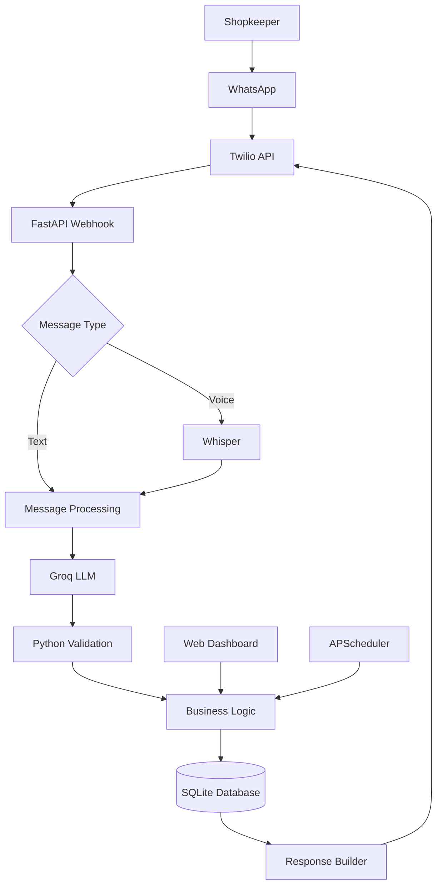
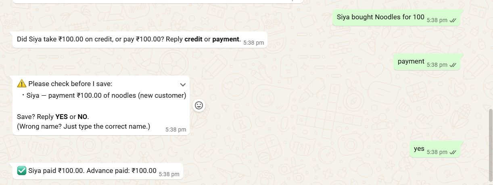
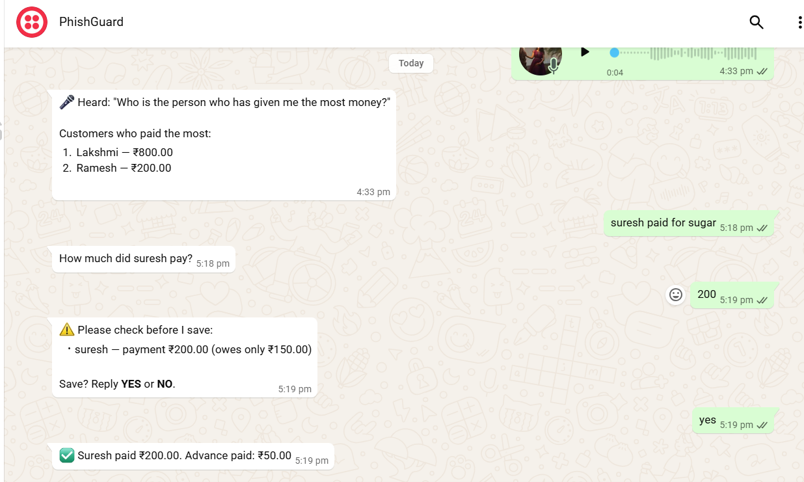
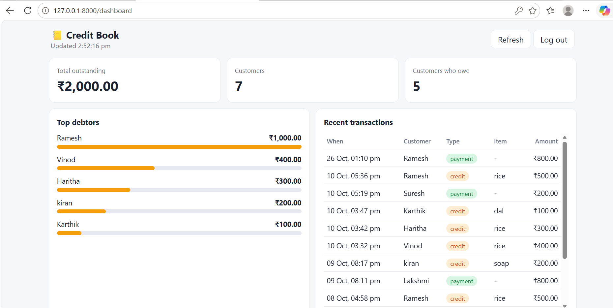

# WhatsApp Credit Assistant

**A simple WhatsApp-based credit ledger for small shopkeepers.**

Record customer credit sales and payments through text messages or voice notes, check outstanding balances, and keep track of transactions without maintaining a manual notebook.

## Project Overview

WhatsApp Credit Assistant is a bookkeeping application designed to help small shopkeepers manage customer credit and payment records.

A shopkeeper can send a message such as:

> Ramesh took 500 rupees of rice on credit.

The assistant understands the message, extracts the transaction details, validates the information and stores the entry in the database.

It also supports voice messages and questions about customer balances, top debtors and recent transactions.

The project includes a simple web dashboard that provides a ledger-style overview of customer balances and transactions.

## Problem Statement

Small shopkeepers often maintain customer credit records in notebooks. Keeping track of multiple customers, payments and outstanding balances manually can become difficult and time-consuming.

This project explores how WhatsApp and AI-based message processing can make everyday credit record management easier.

## Features

**1. Text-based transaction recording**
- Record customer credit purchases using natural language.
- Record customer payments.
- Handle multiple transactions.
- Create new customer records after confirmation.

**2. Voice message support**
- Accept WhatsApp voice notes.
- Convert speech into text using Whisper.
- Support English, Hindi, Malayalam, Kannada and Tamil, subject to transcription accuracy.

**3. Natural-language queries**

Ask questions through WhatsApp, such as:
- How much does Ramesh owe?
- Who owes me the most?
- Who has paid the most?
- Show today's transactions.

**4. Transaction validation**
- Ask for missing information instead of guessing.
- Validate transaction amounts against the original message.
- Request confirmation for new customers, possible duplicate entries and payments exceeding the outstanding balance.
- Handle invalid or unclear messages.

**5. Ledger-style web dashboard**

The dashboard provides:
- Total outstanding amount.
- Total number of customers.
- Number of customers who owe money.
- Top debtors.
- Recent transactions.
- Individual customer balances.
- Customer search.

**6. Automated reminders**
- Schedule daily overdue-balance summaries.
- Send reminders to the shop owner through WhatsApp.

**7. Security**
- Twilio webhook signature verification.
- Authorized sender restrictions.
- Duplicate webhook protection.
- Token-protected dashboard and API routes.

## How It Works

The application follows this workflow:

1. The shopkeeper sends a text message or voice note through WhatsApp.
2. Twilio forwards the message to the FastAPI webhook.
3. If it is a voice note, Whisper converts it into text.
4. The Groq-hosted LLM identifies the user's intent and extracts the transaction details.
5. Python validates the extracted information and checks for missing details.
6. The application requests confirmation when necessary.
7. Valid transactions are processed and stored in the SQLite database using SQLAlchemy.
8. The assistant sends a response through WhatsApp.

**Important design decision:** The LLM understands the message, while Python handles validation, calculations and database operations. The LLM does not directly modify financial records.

## Architecture



## Tech Stack

| Category | Technology |
|---|---|
| Programming Language | Python |
| Backend | FastAPI |
| Messaging | Twilio WhatsApp API |
| LLM Integration | Groq |
| Speech Recognition | Whisper |
| Validation | Pydantic |
| Database | SQLite |
| ORM | SQLAlchemy |
| Task Scheduling | APScheduler |
| Dashboard | HTML, CSS, JavaScript |
| Containerization | Docker, Docker Compose |
| Reverse Proxy | Caddy |
| Cloud Platform | AWS EC2 |
| Testing | Pytest |
| Version Control | Git, GitHub |

## Example WhatsApp Conversations

**1. Recording a credit transaction**

```text
You: Ramesh took 500 rupees of rice on credit

Bot: Please check before I save:
     Ramesh - credit ₹500.00 of rice
     (New customer)

     Save? Reply YES or NO.

You: yes

Bot: Ramesh took ₹500.00 of rice on credit.
     Total owed: ₹500.00
```

**2. Recording a payment**

```text
You: Ramesh paid 200

Bot: Ramesh paid ₹200.00.
     Total owed: ₹300.00
```

**3. Asking about outstanding balances**

```text
You: Who owes me the most?

Bot: Top debtors:
     1. Ramesh - ₹300.00
     2. Suresh - ₹150.00
```

**4. Processing a voice message**

```text
You: [Voice note]
     "Ramesh took five hundred rupees
      of rice on credit"

Bot: Heard:
     "Ramesh took five hundred rupees
      of rice on credit"

     Ramesh took ₹500.00 of rice on credit.
     Total owed: ₹500.00
```

## Screenshots


| WhatsApp text interaction | WhatsApp voice interaction |
|---|---|
|  |  |

|  Web dashboard |
|---|
|  |


## Setup Instructions

### Prerequisites

- Python 3.12 or newer
- Groq API key
- Twilio account with WhatsApp Sandbox enabled
- ngrok or another HTTPS tunnelling service

### 1. Clone the repository

```bash
git clone https://github.com/123dithya4/whatsapp-credit-assistant.git

cd whatsapp-credit-assistant
```

### 2. Create a virtual environment

```bash
python -m venv venv
```

Activate it on Windows PowerShell:

```powershell
venv\Scripts\Activate.ps1
```

### 3. Install dependencies

```bash
pip install -r requirements.txt
```

### 4. Configure environment variables

Create your `.env` file:

```powershell
copy .env.example .env
```

Add your required credentials and application settings.

Do not commit your `.env` file or expose API keys and authentication tokens.

### 5. Run the application

```bash
python -m uvicorn app.main:app --reload --port 8000
```

Open the following URLs:

- Dashboard: `http://127.0.0.1:8000/dashboard`
- Health check: `http://127.0.0.1:8000/health`
- API documentation: `http://127.0.0.1:8000/docs`

### 6. Connect Twilio WhatsApp Sandbox

Expose your local application:

```bash
ngrok http 8000
```

Configure the generated HTTPS address as the public application URL.

In the Twilio Console, set the incoming message webhook to:

```text
https://<your-host>/whatsapp/webhook
```

Select `POST` as the HTTP method and save the configuration.

## Docker and AWS Deployment

The project includes Docker and Docker Compose configuration for deployment on AWS EC2.

The deployment setup uses:

- Ubuntu Server on AWS EC2.
- Docker and Docker Compose.
- FastAPI application.
- Caddy reverse proxy with HTTPS.
- DuckDNS hostname.
- SQLite database stored in a Docker volume.

To build and start the containers:

```bash
docker compose up -d --build
```

Check the running containers:

```bash
docker compose ps
```

View application logs:

```bash
docker compose logs -f
```

**Deployment status:** The EC2 setup and Docker deployment commands have been carried out. Local functional testing has been completed, but end-to-end verification on EC2, including the live WhatsApp webhook and dashboard, is still pending.

## Testing

The project includes automated tests and local functional testing.

Run the automated tests using:

```bash
python -m pytest -q
```

Test scenarios include:

- Credit transaction recording.
- Payment recording.
- Multiple transactions for one customer.
- Customer balance calculation.
- Top debtor identification.
- Today's transaction retrieval.
- Voice message processing.
- Missing amount handling.
- Unknown customer handling.
- Invalid input handling.
- Duplicate message handling.
- Transaction confirmation.

A separate script is available for testing intent recognition with the configured live LLM:

```bash
python -m tests.eval_intents
```

## Project Structure

```text
whatsapp-credit-assistant/
│
├── app/
│   ├── main.py
│   ├── config.py
│   ├── database.py
│   ├── models.py
│   ├── schemas.py
│   ├── security.py
│   │
│   ├── routes/
│   │   ├── whatsapp.py
│   │   ├── dashboard.py
│   │   ├── customers.py
│   │   ├── transactions.py
│   │   └── assistant.py
│   │
│   ├── services/
│   │   ├── llm.py
│   │   ├── speech.py
│   │   ├── entries.py
│   │   ├── assistant.py
│   │   ├── actions.py
│   │   ├── transactions.py
│   │   ├── customers.py
│   │   ├── confirmations.py
│   │   └── reminders.py
│   │
│   └── static/
│       └── dashboard.html
│
├── tests/
├── docs/
│   └── screenshots/
├── Dockerfile
├── docker-compose.yml
├── Caddyfile
├── requirements.txt
├── .env.example
└── README.md
```

## Known Limitations

- The application currently uses the Twilio WhatsApp Sandbox.
- Users must join the sandbox before interacting with the assistant.
- Authorized senders currently share one ledger.
- Speech recognition accuracy can vary depending on language, accent and audio quality.
- SQLite is suitable for a small-scale demonstration but may need to be replaced as the application grows.
- End-to-end EC2 deployment testing is pending.

## Future Improvements

- Separate ledgers for multiple shopkeepers.
- Improve customer name matching and typo correction.
- Add customer payment reminders with consent.
- Migrate to PostgreSQL for larger deployments.
- Add dashboard charts and CSV export.
- Improve speech recognition across languages and accents.

## Author

**Dithya**

- GitHub: [github.com/123dithya4](https://github.com/123dithya4)
- LinkedIn: [linkedin.com/in/dithya-m-07a515361](https://linkedin.com/in/dithya-m-07a515361)

Built as a hands-on project exploring WhatsApp integration, voice processing, LLM tool calling, backend development, database management, testing and cloud deployment.
